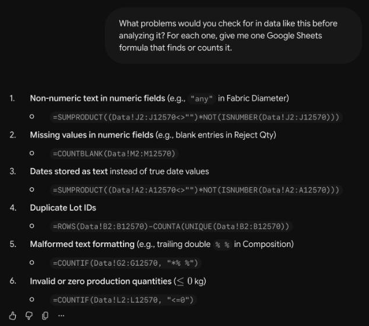
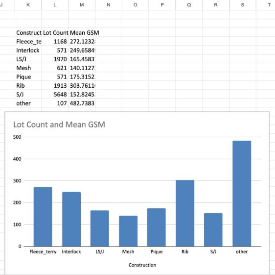
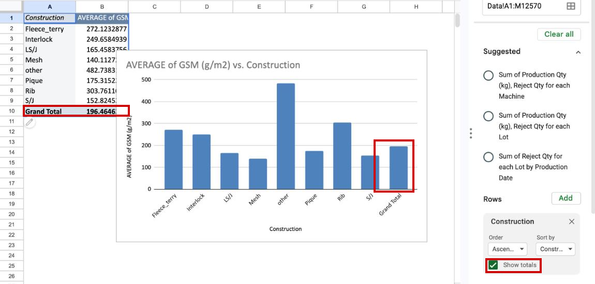

Describe the data to Gemini, ask for formulas, and run them in your copy. Gemini never sees a real row.

::: {.callout-note}
## Before you start

Open your copy of the practice sheet and [Gemini](), signed in with your NC State account. See
[Setup](setup.qmd).
:::

::: {.callout-tip}
## Pace

Problems by minute 19, summary by 25, checks by 31. Behind? Move on; the extras can wait.
:::

## <span class="step-badge">1</span> Look first, no AI {#look}

[Practice: look first]{.practice}

::: {.callout-note collapse="true" appearance="simple"}
## Watch this step

<video controls preload="none" playsinline class="clip" poster="video/step-1.jpg" src="video/step-1.mp4"></video>

:::

1. **How many rows?** Click a cell in column A and press <kbd>Cmd</kbd> + <kbd>↓</kbd> (Mac) or <kbd>Ctrl</kbd> +
   <kbd>↓</kbd> (Windows). Don't count the header.
2. **How many columns, in what units?** See the column names and the Dictionary tab.
3. **What is one row?** Guess from the first rows, then check line 2 of the Dictionary tab.

::: {.callout-tip collapse="true"}
## Check your answers

::: {.answer}
<span class="answer-label">Rows of data</span><span class="answer-value"></span>
:::

 columns. One row is one lot knitted on one day, so the same fabric repeats. Production Qty
is in kg; Reject Qty has no stated unit.
:::

## <span class="step-badge">2</span> Data security {#security}

[Practice: mind the data]{.practice}

::: {.callout-note collapse="true" appearance="simple"}
## Watch this step

<video controls preload="none" playsinline class="clip" poster="video/step-2.jpg" src="video/step-2.mp4"></video>

:::

1. In Gemini, check the bottom left for your name with **Edu** under it.
2. You won't upload anything today; you'll describe the data. That works for any data you may keep in your NC State
   Drive. For your own data, see the [decision guide](data-security.qmd#guide).

## <span class="step-badge">3</span> Describe the data {#describe}

[Practices: say what Gemini is looking at · mind the data]{.practice}

::: {.callout-note collapse="true" appearance="simple"}
## Watch this step

<video controls preload="none" playsinline class="clip" poster="video/step-3.jpg" src="video/step-3.mp4"></video>

:::

Start a **New chat** in Gemini and send:

::: {.prompt}
```default
I'm a textile graduate student working in Google Sheets. I won't share the data itself, only its structure.

My sheet has a tab named Data, range : one header row and  rows. Each row is one lot knitted on one day in a knitting factory, June to August 2022. Here are the header row and 5 made-up rows in the same format:

Production Date,Lot,Machine,Machine Diameter (in),Machine Gauge (needles/in),Construction,Composition (as recorded),Yarn Count (as recorded),Stitch Length (mm),Fabric Diameter (in),GSM (g/m2),Production Qty (kg),Reject Qty
2022-06-03,DEMO-101,Fukuhara,30,24,S/J,Cotton 100%,30/1,2.85,60,140,412.5,0
2022-06-03,DEMO-102,Pailung,34,24,LS/J,95% Cotton 5% Elastane %,"30/1,20/D",2.7,68,180,288,
2022-06-04,DEMO-103,Jiunn Long,30,20,Fleece_terry,80% Cotton 20% Polyester %,"30/1,20/1",3.2,72,260,175.25,2
2022-06-04,DEMO-104,Lisky,36,24,Rib,Cotton 100%,26/1,2.9,any,220,95,0
2022-06-05,DEMO-105,Hangxing,32,28,Mesh,100% Polyester %,75D/72F,2.6,66,140,310.8,

Notes: Construction is a code (S/J is single jersey, LS/J is Lycra single jersey). Yarn Count is text in the factory's notation (30/1 is cotton count, 20/D is denier), with several yarns separated by commas. Reject Qty has no stated unit.

I'll ask for formulas one at a time and put them on a tab named Work. Keep your answers short.
```
:::

::: {.watch}
Gemini should just say it's ready. For your own data, send the same four things: layout, header row, made-up rows,
notes.
:::

## <span class="step-badge">4</span> Find the problems {#problems}

[Practices: ask for formulas, not just answers · watch for quiet fixes]{.practice}

::: {.callout-note collapse="true" appearance="simple"}
## Watch this step

<video controls preload="none" playsinline class="clip" poster="video/step-4.jpg" src="video/step-4.mp4"></video>

:::

::: {.prompt}
```default
What problems would you check for in data like this before analyzing it? For each one, give me one Google Sheets formula that finds or counts it.
```
:::

Paste each formula into the **Work** tab, from A3 down.

::: {.watch}
Does each check fit what a row is? Lots repeat by design. Which of the  problems did it miss?
:::

::: {.callout-note collapse="true" appearance="simple"}
## What it looked like when we tried it

{.shot fig-alt="Gemini's answer to the problems prompt: six numbered checks, each with a Google Sheets formula. Non-numeric text in Fabric Diameter, blank Reject Qty, dates stored as text, duplicate Lot IDs, Composition entries ending in a double percent sign, and production quantities of zero or less."}
:::

::: {.callout-tip collapse="true"}
## The  problems in this data

1. **Reject Qty** is blank in  rows: no rejects, or not recorded?
2. **Reject Qty** holds a note in row , the factory correcting a date.
3. **Fabric Diameter** says "any" in  rows.
4. **Composition** is blank in  rows and just "%" in
   .
5. ** rows are exact copies** of an earlier row. Ask the data's owner before dropping them.
6. **Lot** says "nan" in  rows, a missing lot written as text.
7. **Machine Gauge** is  in one row, a typo.
8. **Yarn Count** mixes notations: `30/1`, `20/D`, `75D/72F`, and several yarns per cell.

These find the ones Gemini often misses (, ,
, 1):

```default
=ROWS(Data!A2:M)-ROWS(UNIQUE(Data!A2:M))
=COUNTIF(Data!B2:B,"nan")
=MAX(Data!E2:E)
=SUMPRODUCT((Data!M2:M<>"")*NOT(ISNUMBER(Data!M2:M)))
```
:::

## <span class="step-badge">5</span> Summarize, with a chart {#summary}

[Practice: ask for formulas, not just answers]{.practice}

::: {.callout-note collapse="true" appearance="simple"}
## Watch this step

<video controls preload="none" playsinline class="clip" poster="video/step-5.jpg" src="video/step-5.mp4"></video>

:::

::: {.prompt}
```default
Give me one formula that lists each Construction with its number of rows and its mean GSM. Then tell me how to make a chart of the means.
```
:::

Paste the formula into an empty part of the Work tab, then follow the chart steps.

::: {.watch}
All  constructions there? A "Lot Count" column counts rows, not lots. Write the S/J mean
in **Compare → First way**.
:::

::: {.callout-note collapse="true" appearance="simple"}
## What it looked like when we tried it

{.shot fig-alt="A table on the Work tab listing eight constructions with their row counts and mean GSM, and below it a column chart of mean GSM by construction, with 'other' and Rib the tallest bars."}
:::

::: {.callout-tip collapse="true"}
## A formula that works

```default
=QUERY(Data!F2:K, "SELECT F, COUNT(F), AVG(K) WHERE F IS NOT NULL GROUP BY F LABEL F 'Construction', COUNT(F) 'Rows', AVG(K) 'Mean GSM'")
```

Chart: select the table, **Insert → Chart**, **Column chart**, then remove the Rows series.
:::

## <span class="step-badge">6</span> Check it a second way {#check}

[Practice: check numbers two ways]{.practice}

::: {.callout-note collapse="true" appearance="simple"}
## Watch this step

<video controls preload="none" playsinline class="clip" poster="video/step-6.jpg" src="video/step-6.mp4"></video>

:::

::: {.prompt}
```default
Give me a different formula for the mean GSM of the rows whose Construction is exactly S/J, so I can check the first one.
```
:::

Put the result in **Compare → Second way**. For **Data rows**, use your step 1 count and `=COUNTA(Data!A2:A)`.

::: {.watch}
"Exactly" matters: `*S/J*` also catches LS/J.
:::

::: {.callout-note collapse="true" appearance="simple"}
## A third way: a pivot table

1. Click a cell in the data, then **Insert → Pivot table → Create**.
2. Remove any fields the editor filled in for you.
3. **Rows → Add → Construction.**
4. **Values → Add → GSM (g/m2)**, then change **SUM** to **AVERAGE**. MEDIAN and STDEV are in the same list.
5. To chart it, untick **Show totals** first (or you get a Grand Total bar), then **Insert → Chart**.

{.shot fig-alt="A pivot table of average GSM by construction with a Grand Total row, a column chart that includes a Grand Total bar, and the pivot editor's Rows card with Show totals ticked. The Grand Total row, the Grand Total bar and the Show totals checkbox are outlined in red."}
:::

::: {.callout-note collapse="true" appearance="simple"}
## What a wrong number tells you

| You got | Because |
| --- | --- |
|  rows | The header was counted. |
|  rows | The  copies were dropped. |
|  for S/J | LS/J was caught too. |
|  for Reject Qty | Blanks were counted as zero. |
|  repeated lots | Not an error: lots run for days. |
:::

## <span class="step-badge">7</span> What does a blank mean? {#blanks}

[Practice: watch for quiet fixes]{.practice}

::: {.callout-note collapse="true" appearance="simple"}
## Watch this step

<video controls preload="none" playsinline class="clip" poster="video/step-7.jpg" src="video/step-7.mp4"></video>

:::

::: {.prompt}
```default
Write a formula for the mean Reject Qty. Should the blank cells count as zero?
```
:::

::: {.watch}
Put both of Gemini's answers on the **Mean Reject Qty** row. They differ on purpose: which would you report, and how
would you find out?
:::

::: {.callout-tip collapse="true"}
## The numbers, if you ran out of time

| Statistic | Value |
| --- | --- |
| Rows of data |  |
| Mean GSM, S/J |  |
| Mean Reject Qty, blanks skipped |  |
| Mean Reject Qty, blanks as zero |  |
:::

## <span class="step-badge">8</span> Your own data {#own-data}

[Practices: look first · mind the data]{.practice}

::: {.callout-note collapse="true" appearance="simple"}
## Watch this step

<video controls preload="none" playsinline class="clip" poster="video/step-8.jpg" src="video/step-8.mp4"></video>

:::

Fill in the [plan for your own data](practices.qmd#own-data), on a new tab or on paper.

## Extras

::: {.callout-note collapse="true" appearance="simple"}
## Clean up Composition with a list of values

Composition has  spellings. A list of distinct entries is often fine to share when rows
aren't:

```default
=SORT(UNIQUE(Data!G2:G))
```

Paste the list into Gemini and ask for a rule that groups entries by fiber, then a `REGEXMATCH` column that applies
it. Does it know Lycra, Creora and "Ly" are elastane, CVC is cotton and polyester, and "Sea-shell" is SeaCell? The
dataset's author filed "95% Viscose-5% Elastan" under Polyester. Would you?
:::

::: {.callout-note collapse="true" appearance="simple"}
## Mean, median and standard deviation in one formula

::: {.prompt}
```default
Write one formula that lists each Construction with the mean, median and standard deviation of its GSM.
```
:::

`QUERY` can't do median or standard deviation; it fails with "Unable to parse query string". Paste the error back.
One that works:

```default
=LET(c, SORT(UNIQUE(Data!F2:F)), g, Data!K2:K, k, Data!F2:F, HSTACK(c, MAP(c, LAMBDA(x, AVERAGE(FILTER(g, k = x)))), MAP(c, LAMBDA(x, MEDIAN(FILTER(g, k = x)))), MAP(c, LAMBDA(x, STDEV(FILTER(g, k = x))))))
```
:::

::: {.callout-note collapse="true" appearance="simple"}
## Stitch length and GSM, group by group

::: {.prompt}
```default
Write a formula for the correlation between Stitch Length and GSM for each Construction.
```
:::

Overall the correlation is near zero (); within Interlock it's about 
and within Pique . Be careful: the same fabric repeats on many rows, and heavier yarns go with
longer stitches.
:::

::: {.callout-note collapse="true" appearance="simple"}
## Research questions, without the data

::: {.prompt}
```default
Based on the columns I described, suggest three research questions this data could answer, and the analysis each would need.
```
:::

Could each one really be answered from these columns?
:::

## If something goes wrong

| What happens | Try |
| --- | --- |
| `#REF!` | Move the formula to an empty area; it needs room to spill. |
| `#N/A`, `#VALUE!`, `#ERROR!` | Paste the formula and the error into Gemini. |
| Wrong column | Give Gemini the right column letter. |
| Gemini asks for the file | Say you'll only share the structure. |
| Menus don't match | Tell Gemini what you see. |
| Out of time | Use the numbers in step 7. |

<p class="small-muted">Checked ; if a screen differs, Google's
<a href="">Gemini help</a> wins. Feedback:
<a href="">go.ncsu.edu/dss-workshop-eval</a>. Help: <a href="">go.ncsu.edu/getdatahelp</a>.</p>
