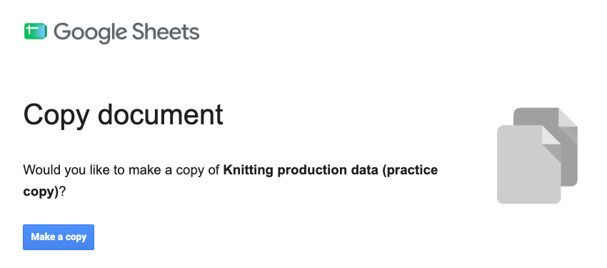
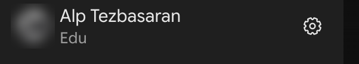
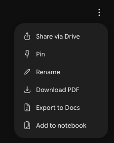
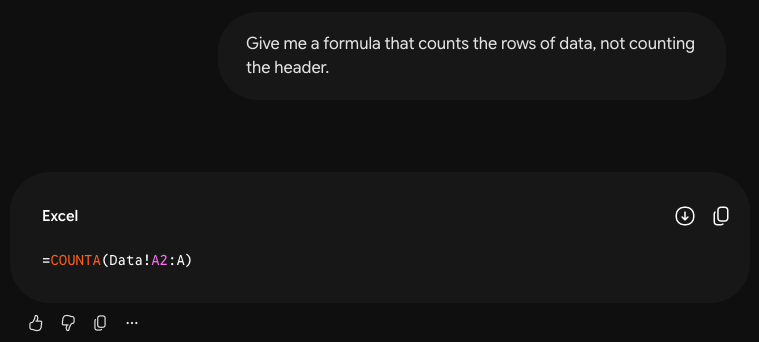
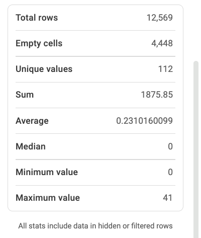
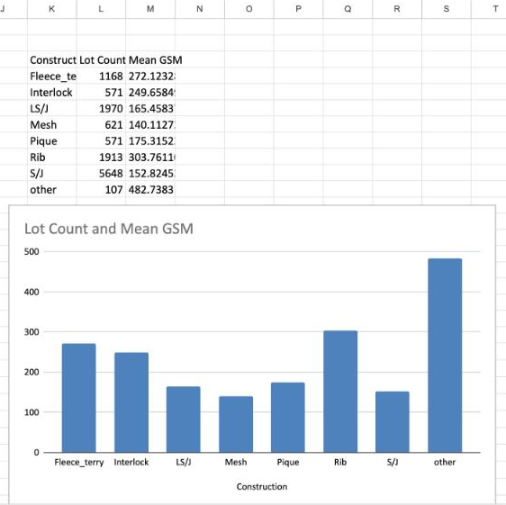

[ ·  · ]{.small-muted}

::: {.callout-important}
## How to use this guide

This is the page we work from in the session. Every step is written out, so you can follow along, catch up if you
fall behind, and come back to it later.

- You need a laptop and your NC State login. There is nothing to install and no code to write.
- A dark box holds a prompt for Gemini, and a light box holds a formula for Google Sheets. Each has a **Copy** button.
- An **Answer key** opens when you click it. Try the step first.
:::

# Welcome {#welcome .unnumbered}

Most research data passes through a spreadsheet at some point, whether it's test results, production records or
survey exports. Before you analyze it, you need to know what is in it and whether you can trust it. That first look
is called exploratory data analysis.

Today we do it in Google Sheets, with a real dataset from a knitting factory and with help from Gemini. Gemini never
sees a row of the data. We describe the sheet to it, it writes formulas, and we run them in our own copy and check
what comes back.

By the end of this session you will be able to:

- Recognize when you can upload data to an AI tool, and when to describe it instead.
- Describe a dataset to Gemini so that its formulas work in your sheet as they are.
- Check a dataset for wrong data types, missing values, duplicates, inconsistent categories and values out of range.
- Summarize a variable by group, and chart it.
- Check a formula Gemini wrote against a number you found yourself, and keep a record of what you asked.

## The questions we'll answer {#questions .unnumbered}

| | Question | Where |
| - | ---------------- | ----- |
| 1 | What can we share with an AI tool? | @sec-security |
| 2 | What is one row of this data, and how many are there? | @sec-workbook |
| 3 | Can we trust these values? | @sec-prepare |
| 4 | Does a blank mean zero? | @sec-missing |
| 5 | How heavy is each kind of fabric? | @sec-summary |

## About the data {#about-the-data .unnumbered}

The practice data is real. It comes from a knitting factory's daily production reports for
 to . It has  rows, and each row is one lot
knitted on one day on one machine.  of Daffodil International University published it on
[Mendeley Data]() under a  license, so anyone may reuse it with
credit.

**Cite it as:**  []()

We changed three things.

- We kept  of the 38 columns and named them with their units.
- We kept **Composition** as it was typed in the factory's report,  spellings and all. The
  published file also has a tidied version of that column, which puts some blends in the wrong group.
- We saved the file as UTF-8, removed invisible spaces, and made the dates real dates.

Everything else is as the factory recorded it, problems included. Finding them is part of the session.

The same fabric repeats on many rows, so a count of rows is not a count of fabrics.

# What can you share with an AI tool? {#sec-security}

[Question 1: What can we share with an AI tool?]{.question}

Before you share data with any AI tool, check your account, how sensitive the data is, and any agreement that covers
it.

## Your account {#sec-account}

Use Gemini with your NC State login. NC State's [approved AI list]() rejects the
free public version for university data. With your NC State account, chats and uploads "won't be reviewed by human
reviewers or otherwise used to improve generative AI models" ([Google's education FAQ]()).
Your Gemini activity is kept, and you can't turn that off.

## How sensitive is the data? {#sec-levels}

NC State's [Data Management Framework]() has four levels.

| Level | Risk if disclosed | Examples |
| ------ | ---- | ------------ |
| **Purple**, ultra-sensitive | Highest | Social Security numbers, passwords, encryption keys, biometrics |
| **Red**, highly sensitive | High | Driver's license and passport numbers, mother's maiden name, immigration numbers |
| **Yellow**, moderately sensitive | Moderate to low | Date of birth, race, gender, transcripts |
| **Green**, not sensitive | Low | Data that's already public, like the practice data |

Unclassified data counts as at least yellow. For research data, ask your PI.

**Gemini with your NC State login is approved up to red. Never purple.**

## Agreements come first {#sec-agreements}

An agreement can be stricter than the approved list. These are common in textiles research.

- An industry partner's NDA (production reports, recipes, test results)
- A sponsor's terms
- An IRB protocol and consent form (surveys, interviews, fit studies)
- A data use agreement
- Export control

If one applies, or you're not sure, ask the PI or whoever signed it before you share anything. The stricter rule wins.

## Upload it, or describe it? {#sec-share}



To describe data, you send Gemini the layout, the column names and a few made-up rows, and you run its formulas in
your sheet. The data never leaves it.



Today we describe. The practice data is public, so it's green, and uploading it would be allowed. We describe it
anyway. That works for any data you may keep in your NC State Drive, and every number then comes from a formula you
can read and run again.

<p class="small-muted">Checked against NC State's <a href="">approved AI list</a>
and <a href="">Data Management Framework</a> on . They
win if they disagree with this page.</p>

# Set up your workbook {#sec-workbook}

[Question 2: What is one row of this data, and how many are there?]{.question}

## Make your copy {#sec-copy}

1. Open the [copy link](). If Google asks you to sign in, use your NC State account. Google
   Sheets then asks whether you'd like to make a copy of *Knitting production data (practice copy)*.
2. Click **Make a copy**. Your copy opens, named "Copy of Knitting production data (practice copy)". It's yours
   alone, so nothing you do in it can break anyone else's.

{.shot width="560" fig-alt="A Google Sheets page titled Copy document. It asks: Would you like to make a copy of Knitting production data (practice copy)? Below is a blue Make a copy button."}

## What's in the workbook {#sec-tabs}

The workbook has five tabs, and each has one job.

| Tab | What it's for |
| --- | ---------------- |
| **Data** | The  rows. Nothing gets typed here. |
| **Dictionary** | What each column holds, its unit, and what its codes mean. |
| **Work** | Gemini's formulas. Single numbers go at the top, each next to its name, and tables go below. |
| **Log** | A record of what you asked and what you changed. |
| **About** | Where the data comes from, its license, and what we changed. |

These are the Data tab's columns.



The Dictionary tab says more about each column, and explains the Construction codes and the Yarn Count notation.
The codes are also in the [Reference](#codes) at the end of this page.

## Find your way around the data {#sec-look}

1. Click the **Data** tab. Row 1 holds the column names, and it stays in view as you scroll.
2. Click any cell in column A, then press <kbd>Ctrl</kbd> + <kbd>↓</kbd> (Mac: <kbd>Cmd</kbd> + <kbd>↓</kbd>) to jump
   to the last row. Its row number is one more than the number of rows of data, because of the header.
   <kbd>Ctrl</kbd> + <kbd>↑</kbd> takes you back up.
3. Read the column names. Which measurements have a unit, and which don't?
4. What is one row? Guess from the first few rows, then read line 2 of the **Dictionary** tab.
5. Click the **Work** tab and type your row count in cell , under *Do it yourself*. You'll
   check Gemini against it in @sec-prepare.

::: {.callout-note collapse="true" icon=false}
## Answer key

The last row is , so there are  rows of data, in
 columns. One row is one lot knitted on one day on one machine, so a lot can have several
rows a day. Production Qty is in kg, and Reject Qty has no stated unit.
:::

# Set up Gemini {#sec-gemini}

## Sign in {#sec-signin}

1. Go to [gemini.google.com]() and sign in with your NC State account. If a welcome page comes
   up, click **Chat with Gemini**, then **Use Gemini**.
2. **Check:** the bottom left corner says **Edu**, under your name or next to your picture. If it doesn't, switch to
   your NC State account.

   {.shot width="300" fig-alt="The bottom left corner of Gemini: a blurred profile photo, the name Alp Tezbasaran, and the word Edu under it."}

3. Click the mode button in the box where you type, and choose **Thinking**.

   {.shot width="520" fig-alt="Gemini's prompt box with the mode menu open. It lists three modes: All-around help, 3.6 Flash; Solves complex problems, 3.6 Thinking, which has a check mark; and Detailed research, 3.1 Pro."}

Does the mode matter? A little. When we tried all three, Flash was the quickest, and one of its formulas used a
function that doesn't exist. Every formula from Thinking and Pro ran. Pro has a usage limit, and when it was busy
Gemini answered with another mode. In any mode, you run the formula and check the number, so a mistake shows up.

## Describe your data {#sec-describe}

Start a **New chat** and send this prompt.

::: {.prompt}
```default
I'm a textile graduate student working in Google Sheets. I won't share the data itself, only its structure.

My sheet has a tab named Data, range : one header row and  rows. Each row is one lot knitted on one day in a knitting factory, June to August 2022. Here are the header row and 5 made-up rows in the same format:

Production Date,Lot,Machine,Machine Diameter (in),Machine Gauge (needles/in),Construction,Composition (as recorded),Yarn Count (as recorded),Stitch Length (mm),Fabric Diameter (in),GSM (g/m2),Production Qty (kg),Reject Qty
2022-06-03,DEMO-101,Fukuhara,30,24,S/J,Cotton 100%,30/1,2.85,60,140,412.5,0
2022-06-03,DEMO-102,Pailung,34,24,LS/J,95% Cotton 5% Elastane %,"30/1,20/D",2.7,68,180,288,
2022-06-04,DEMO-103,Jiunn Long,30,20,Fleece_terry,80% Cotton 20% Polyester %,"30/1,20/1",3.2,72,260,175.25,2
2022-06-04,DEMO-104,Lisky,36,24,Rib,Cotton 100%,26/1,2.9,any,220,95,0
2022-06-05,DEMO-105,Hangxing,32,28,Mesh,100% Polyester %,75D/72F,2.6,66,140,310.8,

Notes: Construction is a code (S/J is single jersey, LS/J is Lycra single jersey). Yarn Count is text in the factory's notation (30/1 is cotton count, 20/D is denier), with several yarns separated by commas. Reject Qty has no stated unit.

I'll ask for formulas one at a time and put them on a tab named Work. Keep your answers short. Put each formula on one line, in its own code block, so I can copy it.
```
:::

**Check:** Gemini should only say that it's ready.

The prompt has six parts, and each one is there for a reason.



| | Part | Why it's there |
| - | ---------- | ------------------ |
| [1]{.num} | Who you are, and that you'll share only the structure | Gemini then doesn't ask for the file. |
| [2]{.num} | The tab and the range | Gemini's formulas then point at your real cells, so you can paste them in as they are. |
| [3]{.num} | What one row is | Whether a repeated lot is a problem depends on it. |
| [4]{.num} | The column names, with five made-up rows in your data's format | A column's position gives its letter, and its name gives the unit. The rows show its data type, which may be a number, text, a date, a blank, or an odd value such as "any". |
| [5]{.num} | Notes | These cover codes, units and anything else the names don't say. |
| [6]{.num} | How you want the answers | You get one formula at a time, in a box you can copy. A formula written on several lines would land in several cells when you paste it. |

The five rows are invented. They use codes from the data, such as S/J, but none of them is a row of the data.

## Keep a record {#sec-record}

Gemini may answer the same question differently tomorrow, and a chat is easy to lose. Keep your own record of what
you asked and what you did with the answer.

| Way | How |
| ---- | ---------------- |
| Pin the chat | Open the ⋮ menu at the top right of the chat and click **Pin**. |
| Export the chat | The same menu has **Download PDF** and **Export to Docs**. |
| Keep a log | The **Log** tab has a row for each thing you ask. It holds the date, what you asked, the formula or steps you used, what changed in the data, and how you checked it. |

{.shot width="210" fig-alt="The menu at the top right of a Gemini chat: Share via Drive, Pin, Rename, Download PDF, Export to Docs, Add to notebook."}

The formulas are a record too. They stay on the Work tab, next to their names.

Today's data is for practice, so you can leave the Log empty. In your own work, fill it in as you go.

# Preparing the data {#sec-prepare}

[Question 3: Can we trust these values?]{.question}

Before you summarize data, check it. Five checks catch most problems. They cover data types, missing values,
duplicates, categories, and values out of range. Each check below says what to look for and how to look yourself, and
Gemini writes the formula.

None of the checks changes the data. They count problems, and you decide what to do about each one.

## How a check works {#sec-pattern}

The first formula counts the rows, which you have already done by hand.

1. In Gemini, send this prompt.

   ::: {.prompt}
   ```default
   Give me a formula that counts the rows of data, not counting the header.
   ```
   :::

2. Click the copy button on Gemini's formula box.

   {.shot width="560" fig-alt="A Gemini chat. The prompt asks for a formula that counts the rows of data. The answer is one box labeled Excel that holds a COUNTA formula, with a download button and a copy button at its top right."}

3. In your sheet, click the **Work** tab and then cell , next to
   **. Paste, and press <kbd>Enter</kbd>.
4. Look at column D. It says **match** when Gemini's number and yours agree.

Each single number follows this pattern. Your number goes under *Do it yourself*, Gemini's formula goes under
*AI-assisted*, and column D compares them once both cells are filled. A formula that makes a table goes lower on the
tab, under the table's name.

Gemini's formula may differ from the one in the answer key, and from your neighbor's. There are many ways to write
the same check, so compare the numbers.

To learn what a formula does, ask.

::: {.prompt}
```default
Explain that formula one piece at a time, in plain words, for someone who has never used these functions.
```
:::

::: {.callout-warning}
## Gotcha: the cell shows an error

`#REF!` means the result has no room. It needs empty cells below it and to its right, so clear the cells in its way
or move the formula. For any other error, paste the formula and the error into Gemini and ask for a fix. One of ours
showed `#NAME?`, because Gemini had used a function that doesn't exist. It fixed the formula when we told it.
:::

::: {.callout-warning}
## Gotcha: the formula lands in several cells

Gemini wrote it on more than one line, and Sheets put each line in its own cell. Press <kbd>Ctrl</kbd> + <kbd>Z</kbd>
(Mac: <kbd>Cmd</kbd> + <kbd>Z</kbd>) to undo. Then double-click the cell, paste, and press <kbd>Enter</kbd>.
:::

::: {.callout-note collapse="true" icon=false}
## Answer key

There are  rows. A count of  includes the header.

::: {.formula}
```default
=COUNTA(Data!A2:A)
```
:::

`A2:A` means A2 and everything below it.
:::

## Data types {#sec-types}

A number column should hold only numbers. SUM and AVERAGE skip a cell that holds text, and they don't warn you.

**Do it yourself.** On the **Data** tab, numbers and dates sit on the right of a cell, and text sits on the left.
Scroll down the Fabric Diameter column to row , where a cell says "any".

**AI-assisted.** Send this prompt. Paste the formula on the Work tab in cell , under
**.

::: {.prompt}
```default
Give me one formula that makes a table with one row for each column of my data: the column's name, how many of its cells are blank, how many hold numbers, and how many hold text.
```
:::

**Check:** in each row of the table, the three counts add up to .

A date counts as a number. Which of the number columns hold text?

::: {.callout-note collapse="true" icon=false}
## Answer key



Fabric Diameter says "any" in  rows. Reject Qty holds text in one cell, in row
, where the factory wrote a note about a corrected date. Lot, Machine, Construction,
Composition and Yarn Count are text on purpose.

A formula that works:

::: {.formula}
```default
=LET(d, Data!A2:M, VSTACK({"Column", "Blank", "Numbers", "Text"}, HSTACK(TRANSPOSE(Data!A1:M1), TRANSPOSE(BYCOL(d, LAMBDA(c, COUNTBLANK(c)))), TRANSPOSE(BYCOL(d, LAMBDA(c, COUNT(c)))), TRANSPOSE(BYCOL(d, LAMBDA(c, COUNTA(c)-COUNT(c)))))))
```
:::
:::

## Missing values {#sec-missing}

[Question 4: Does a blank mean zero?]{.question}

A blank cell is the plain kind of missing value. Some values stand in for a blank without being one, such as `nan`,
`any`, a dash or 999. Then comes the harder question of what a blank means. In Reject Qty, a blank could mean that
nothing was rejected, or that nobody wrote the number down.

The table from @sec-types already counts the blank cells of every column. Only Composition and Reject Qty have
any.

**Do it yourself.** On the **Data** tab, click any cell in the Reject Qty column. Open the **Data** menu and choose
**Column stats**. Scroll to the bottom of the panel, and type three numbers on the Work tab.

| From the panel | Type it in |
| ---------------- | ---- |
| Empty cells |  |
| Average |  |
| Sum divided by Total rows, as `=/` |  |

{.shot width="300" fig-alt="The bottom of the Column stats panel for Reject Qty. Total rows 12,569. Empty cells 4,448. Unique values 112. Sum 1875.85. Average 0.2310160099. Median 0. Minimum value 0. Maximum value 41."}

**AI-assisted.** Send this prompt. Gemini should give three formulas, for the count of blanks and for the mean with
blanks skipped and with blanks as zero. Paste them in ,  and
. If it gives only two, ask for the missing one.

::: {.prompt}
```default
Write a formula that counts the blank cells in Reject Qty, and a formula for the mean Reject Qty. Should the blank cells count as zero?
```
:::

**Check:** all three rows say match, and the two means differ. Neither mean is wrong. Which would you report, and
who could tell you what a blank means?

::: {.callout-note collapse="true" icon=false}
## Answer key

| What it is | Value |
| ------------ | ---- |
| Blank cells in Reject Qty |  |
| Mean Reject Qty, blanks skipped |  |
| Mean Reject Qty, blanks as zero |  |

The first mean divides by the  cells that hold a number. The second divides by all
 rows.

Gemini's own answer changed from one chat to the next. In one it said that blanks should usually not count as zero.
In another it said that in a textile mill a blank usually means zero. It can't know which is true here. The factory
does. Formulas that work:

::: {.formula}
```default
=COUNTBLANK(Data!M2:M)
```
:::

::: {.formula}
```default
=AVERAGE(Data!M2:M)
```
:::

::: {.formula}
```default
=SUM(Data!M2:M)/COUNTA(Data!A2:A)
```
:::

Three stand-ins are in this data. Lot says "nan" in  rows, Fabric Diameter says "any" in
, and Composition is just "%" in . None of them is blank,
so a count of blanks misses them all. This one counts the "nan" lots:

::: {.formula}
```default
=COUNTIF(Data!B2:B,"nan")
```
:::
:::

## Duplicates {#sec-duplicates}

Whether a repeat is a problem depends on what one row is. Here a lot runs for several days and on several machines,
so the same lot on many rows is expected. A whole row that repeats, with all  columns alike, is something to ask
about.

**Do it yourself.** The menus have no safe way to count them, because **Data → Data cleanup → Remove duplicates**
deletes the rows. Leave  empty.

**AI-assisted.** Send this prompt, and paste the formula in .

::: {.prompt}
```default
Give me a formula that counts the rows that are an exact copy of an earlier row, comparing all  columns.
```
:::

::: {.callout-note collapse="true" icon=false}
## Answer key

 rows are an exact copy of an earlier row. Ask the data's owner before you drop them,
because the same lot may have been knitted twice in a day.

::: {.formula}
```default
=ROWS(Data!A2:M)-ROWS(UNIQUE(Data!A2:M))
```
:::

A count of repeated lots gives . That isn't a problem, because lots run for days. If a
later count of rows comes to , the copies were dropped.
:::

## Categories {#sec-categories}

In a text column, look for one thing written several ways. Extra spaces, capitals and typos each make a new group in
a summary.

**Do it yourself.** On the **Data** tab, click a cell in the Composition column and open **Column stats** again.
The panel counts the Unique values and lists the most common ones. Type the count in
.

**AI-assisted.** Send this prompt. Paste the three formulas in ,
 and , in that order.

::: {.prompt}
```default
Give me three formulas: the number of different values in Machine, in Construction and in Composition.
```
:::

**Check:** the Composition row says match.

How many ways would you expect a factory to write the fiber content of its fabrics?

::: {.callout-note collapse="true" icon=false}
## Answer key

Machine has  values and Construction has , each spelled one
way. Composition has . The first of the [extra activities](#extras) groups them.

::: {.formula}
```default
=COUNTUNIQUE(Data!C2:C)
```
:::

::: {.formula}
```default
=COUNTUNIQUE(Data!F2:F)
```
:::

::: {.formula}
```default
=COUNTUNIQUE(Data!G2:G)
```
:::
:::

## Values out of range {#sec-range}

Look for numbers that can't be right, such as a negative weight or a gauge in the thousands. The smallest and largest
values of a column show the worst of them.

**Do it yourself.** On the **Data** tab, click a cell in the Machine Gauge column and open **Column stats** again.
Read its Minimum value and its Maximum value.

**AI-assisted.** Send this prompt. Paste the formula on the Work tab in cell , under
**.

::: {.prompt}
```default
Give me one formula that makes a table of the smallest and largest value in each number column: Machine Diameter, Machine Gauge, Stitch Length, Fabric Diameter, GSM, Production Qty and Reject Qty.
```
:::

**Check:** the Machine Gauge row of your table shows the same two values.

Which of the values in the table could a knitting machine really have?

::: {.callout-note collapse="true" icon=false}
## Answer key



- Machine Gauge is  in row , and the next largest is
  . It may be a  run together with the
   in that row's Fabric Diameter.
- Production Qty is 0 in  rows. Column stats lists 0.01 as its most common value, in
   rows. That may be a placeholder.
- One machine is  inches across, and the next smallest is .
- Stitch Length is above 10 mm in  rows, and its median is
  . That is too many rows for a typo. Is it another way of measuring?

Ask before you change any of them. A formula that works:

::: {.formula}
```default
=LET(d, {Data!D2:E, Data!I2:M}, VSTACK({"Column", "Smallest", "Largest"}, HSTACK(TRANSPOSE({Data!D1:E1, Data!I1:M1}), TRANSPOSE(BYCOL(d, LAMBDA(c, MIN(c)))), TRANSPOSE(BYCOL(d, LAMBDA(c, MAX(c)))))))
```
:::
:::

## What else would Gemini check? {#sec-else}

So far this page chose the checks. Now ask Gemini.

::: {.prompt}
```default
What else would you check in this data before analyzing it? For each check, give me one formula that counts the problem.
```
:::

Paste one or two of its formulas in  and , and type what each one
counts in column A beside it. For each one, ask whether the check fits what a row is.

::: {.callout-note collapse="true" icon=false}
## Answer key

Your list will differ from ours. Every time we asked, Gemini offered a count of duplicate lots. Its usual formula
returns , and that isn't a problem, because lots repeat by design.

Twice it also offered a count of rows where Reject Qty is above Production Qty. One of its formulas returns
 and the other . In
 rows, more was rejected than knitted, or the two columns are in different units. The
extra row is the note in row . The first formula counted it, because Sheets ranks text
above every number.
:::

**Checkpoint.** You now know what is in the data and what to be careful with, and nothing in it has changed.

::: {.callout-note collapse="true" icon=false}
## Answer key: what the five checks find in this data

| Check | What it finds |
| ---- | ---------------- |
| Data types | "any" in  Fabric Diameter cells, and a note in Reject Qty in row . |
| Missing values | Reject Qty is blank in  rows. Composition is blank in  and just "%" in . Lot says "nan" in . |
| Duplicates |  rows are an exact copy of an earlier row. |
| Categories | Composition has  spellings. Yarn Count mixes notations, such as `30/1`, `20/D` and `75D/72F`. |
| Values out of range | A gauge of . Production Qty of 0 in  rows and 0.01 in . Reject Qty above Production Qty in  rows. |
:::

# Summarizing and charting {#sec-summary}

[Question 5: How heavy is each kind of fabric?]{.question}

GSM is a fabric's weight in grams per square meter. Construction is its knit structure, such as single jersey (S/J)
or rib.

## A summary table {#sec-table}

Send this prompt. Paste the formula on the Work tab in cell , under
**.

::: {.prompt}
```default
Give me one formula that lists each Construction with its number of rows and its mean GSM. Then tell me how to make a chart of the means.
```
:::

**Check:** the table has all  constructions. Select its
 row counts and read the sum at the bottom right of the window. It should be
.

If Gemini calls the count "Lot Count", remember that it counts rows.

::: {.callout-note collapse="true" icon=false}
## Answer key



A formula that works:

::: {.formula}
```default
=QUERY(Data!A2:M, "SELECT F, COUNT(F), AVG(K) WHERE F IS NOT NULL GROUP BY F LABEL F 'Construction', COUNT(F) 'Row Count', AVG(K) 'Mean GSM'")
```
:::
:::

## A chart {#sec-chart}

Follow Gemini's steps for the chart. Ours were these.

1. Select the table.
2. **Insert → Chart**.
3. In the chart editor, choose **Column chart**.
4. Under **Series**, click the ⋮ next to the row counts and choose **Remove**.

{.shot fig-alt="A table on the Work tab listing eight constructions with their row counts and mean GSM, and below it a column chart of mean GSM by construction, with 'other' and Rib the tallest bars."}

## Do it yourself: a pivot table {#sec-pivot}

A pivot table builds the same table from the menus, with no formula. When its numbers match the formula's, you have
checked a formula you didn't write.

1. Click any cell on the **Data** tab, then **Insert → Pivot table → Create**.
2. Remove any fields the editor filled in for you.
3. **Rows → Add → Construction**.
4. **Values → Add → GSM (g/m2)**, then change **SUM** to **AVERAGE**.
5. Compare the pivot table with your table on the Work tab.

**Check:** S/J is  in both tables.

# Wrapping up {#sec-wrap}

## Take your work with you {#sec-take}

Your copy of the workbook stays in your Google Drive, with every formula on its Work tab. **File → Download** saves it
as an Excel or CSV file. To keep the chat too, pin it or export it (@sec-record).

## How can I apply this to my own dataset? {#sec-own}

The same steps work on your own data, in the same order.

1. Decide what you may share (@sec-security). Check your account, the data's level and any agreement. If you aren't
   sure, ask first.
2. Make a copy to work on, and add a Work tab and a Log tab to it.
3. Look first (@sec-look). Count the rows, read the units, and say what one row is.
4. Describe the data to Gemini. Fill in the brackets, and make the five rows up yourself. Invent the IDs, dates and
   measurements, and keep a real code or category only if you may share it.

   ::: {.prompt}
   ```default
   I'm a [your field] graduate student working in Google Sheets. I won't share the data itself, only its structure.

   My sheet has a tab named [name], range [A1:M100]: one header row and [number] rows. Each row is [what one row is]. Here are the header row and 5 made-up rows in the same format:

   [paste the header row, then 5 rows you made up]

   Notes: [codes, units, anything the column names don't say].

   I'll ask for formulas one at a time and put them on a tab named Work. Keep your answers short. Put each formula on one line, in its own code block, so I can copy it.
   ```
   :::

5. Run the five checks in @sec-prepare. For each one, find a number of your own to compare.
6. Summarize, and check one number another way (@sec-summary).

If you may upload the data, the checks stay the same. Upload only the columns you need.

## What we did {#sec-did}

- We decided what we could share before Gemini saw anything.
- We described the data instead of uploading it.
- We looked first. We counted the rows, read the units and said what one row is.
- We told Gemini what it was looking at, down to the tab and the range.
- We asked for one formula at a time, and ran each one ourselves.
- We checked the data five ways before we summarized it.
- We compared Gemini's numbers with numbers we found ourselves.
- We changed nothing in the data without deciding to.
- We kept each formula on the Work tab, next to a name for what it counts.

Above all, we asked for formulas instead of answers. A formula stays in your sheet, where you can read it, run it
again and check it.

## Where to go next {#sec-next}

- For help with your own data, before or after the session, go to [go.ncsu.edu/getdatahelp]().
- The Libraries' guide [Introduction to Working with Spreadsheets]() covers filters,
  cleaning, pivot tables and charts in Google Sheets.
- The extra activities below give you more practice.
- Tell us how the session went at [go.ncsu.edu/dss-workshop-eval]().

# Extra activities {#extras .unnumbered}

These are for fast finishers, and for practice afterwards. In the session we'll do as many as time allows. Click
one to open it. Their formulas go on the Work tab under **, each in an empty area with
a name typed above it.

::: {.callout-tip collapse="true"}
## Group fabrics by fiber

Composition has  spellings. Textile work usually needs a few groups, such as fabrics with a
stretch fiber and fabrics without.

This activity sends Gemini a list of one column's entries, which is more than a description. The practice data is
public, so that's allowed here. For your own data, decide first whether such a list may be shared (@sec-security).

1. List the different entries. On the Work tab, paste this in cell .

   ::: {.formula}
   ```default
   =SORT(UNIQUE(Data!G2:G))
   ```
   :::

2. Copy the list. Send this prompt, with the list pasted at its end.

   ::: {.prompt}
   ```default
   Below are the different entries in my Composition column. Give me a formula that says TRUE for a fabric with a stretch fiber such as elastane, under any name or spelling in the list, and FALSE for the rest.

   [paste the list here]
   ```
   :::

3. Paste Gemini's formula at the top of the next empty column.

With the list in front of it, Gemini's rule caught Lycra, Spandex, Creora and "Ly", and typos such as Elastan and
Elaasthane. In another chat its rule was shorter, and it missed  rows. This
formula counts the rows the longer rule calls TRUE. It gives .

::: {.formula}
```default
=SUMPRODUCT(--REGEXMATCH(LOWER(Data!G2:G), "ela|spand|lycra|creor|\bly\b"))
```
:::

Two columns should agree here, and they don't. LS/J means Lycra single jersey, yet
 of the  LS/J rows name no stretch fiber in Composition, and
 S/J rows name one. Which column would you trust?

Composition is blank in  rows. A plain `REGEXMATCH` calls them FALSE. This formula
leaves them blank:

::: {.formula}
```default
=MAP(Data!G2:G, LAMBDA(c, IF(c="",, REGEXMATCH(LOWER(c), "ela|spand|lycra|creor|\bly\b"))))
```
:::

This one lists each construction's mean GSM, without a stretch fiber and with one:

::: {.formula}
```default
=ARRAYFORMULA(QUERY({Data!F2:F, REGEXMATCH(LOWER(Data!G2:G), "ela|spand|lycra|creor|\bly\b"), Data!K2:K}, "SELECT Col1, AVG(Col3) WHERE Col1 IS NOT NULL GROUP BY Col1 PIVOT Col2 LABEL Col1 'Construction'"))
```
:::

Interlock with a stretch fiber averages  GSM, against
 without. Fleece and terry goes the other way, at
 against .

For more groups, ask for a TRUE or FALSE column for each fiber in the same way. Grouped by the fibers they name,
 groups hold  of the  rows.



Watch for "60/40 CVC" when you get to polyester. It's a cotton and polyester blend that names neither fiber, in
 rows.
:::

::: {.callout-tip collapse="true"}
## Rows or kilograms? Each construction's share

::: {.prompt}
```default
Give me one formula that lists each Construction with its share of the rows and its share of the total Production Qty, both as percentages.
```
:::

 is % of the rows and % of the
kilograms.  is % of the rows and
% of the kilograms. A row of  holds
 kg on average, and a row of  holds
. A share of the rows and a share of the kilograms answer different questions.



Gemini's formula gave us fractions, such as . To show them as percentages, select
the two columns and click **%** in the toolbar. One that works:

::: {.formula}
```default
=LET(c, UNIQUE(FILTER(Data!F2:F, Data!F2:F<>"")), tot_rows, ROWS(Data!F2:F), tot_qty, SUM(Data!L2:L), VSTACK({"Construction", "Share of Rows", "Share of Production Qty"}, MAP(c, LAMBDA(x, HSTACK(x, COUNTIF(Data!F2:F, x) / tot_rows, SUMIFS(Data!L2:L, Data!F2:F, x) / tot_qty)))))
```
:::
:::

::: {.callout-tip collapse="true"}
## Rejects by machine, and the blanks behind them

::: {.prompt}
```default
Give me one formula that lists each Machine with its total Production Qty, its total Reject Qty, and its number of blank Reject Qty cells.
```
:::



Divide each machine's Reject Qty by its Production Qty.  rejects the most, about
 for every 1,000 kg, and  about
. Now look at the blanks. 's Reject Qty is blank
in  of its  rows, and
's in  of its . If
a blank means that nobody wrote the number down, the lower rate may say more about the records than about the
fabric. Reject Qty also has no stated unit. One that works:

::: {.formula}
```default
=LET(m, UNIQUE(FILTER(Data!C2:C, Data!C2:C<>"")), VSTACK({"Machine", "Total Production Qty", "Total Reject Qty", "Blank Reject Qty"}, MAP(m, LAMBDA(x, HSTACK(x, SUMIFS(Data!L2:L, Data!C2:C, x), SUMIFS(Data!M2:M, Data!C2:C, x), COUNTIFS(Data!C2:C, x, Data!M2:M, ""))))))
```
:::
:::

::: {.callout-tip collapse="true"}
## Production by month, and why one month looks low

::: {.prompt}
```default
Give me one formula that lists each month with its total Production Qty and the number of different Production Dates in it.
```
:::



 has the lowest total,  kg. It also has rows on only
 dates, against . For each date with rows,
 made  kg, the most of the three months. Before you
compare totals, check how many dates each one covers.

Gemini's first formula showed `#N/A` in our sheet. We told it so, and its second formula worked:

::: {.formula}
```default
=ARRAYFORMULA(LET(dates, Data!A2:A, qtys, Data!L2:L, m_text, TEXT(dates, "yyyy-mm"), u_m, UNIQUE(FILTER(m_text, dates<>"")), VSTACK({"Month", "Total Production Qty", "Unique Production Dates"}, BYROW(u_m, LAMBDA(m, HSTACK(m, SUMIF(m_text, m, qtys), COUNTUNIQUE(FILTER(dates, m_text=m))))))))
```
:::
:::

::: {.callout-tip collapse="true"}
## Production day by day, and the days with no rows

::: {.prompt}
```default
Give me one formula that lists each Production Date with its total Production Qty, in date order. Then tell me how to make a line chart of it.
```
:::

The table has  dates, but  to  is
 days. There are no rows from  to , and the
line chart draws straight across them. Fridays average  kg, against
 on other days. Did the factory make nothing on the missing days, or were they not
recorded? Ask before you fill them in. One that works:

::: {.formula}
```default
=QUERY(Data!A2:L, "SELECT A, SUM(L) WHERE A IS NOT NULL GROUP BY A ORDER BY A LABEL A 'Date', SUM(L) 'Production (kg)'")
```
:::

The daily totals should add up to `=SUM(Data!L2:L)`, which is  kg.
:::

::: {.callout-tip collapse="true"}
## The ten largest lots

::: {.prompt}
```default
Give me one formula that lists the 10 lots with the most Production Qty, with each lot's total and its number of rows.
```
:::



The largest lot, , made  kg on 
rows. Look at the  one, . That cell holds two lot numbers
with a comma between them, and  rows have a Lot like it. A count of lots depends on
whether you split those cells. One that works:

::: {.formula}
```default
=QUERY(Data!B2:L, "SELECT B, SUM(L), COUNT(B) WHERE B IS NOT NULL GROUP BY B ORDER BY SUM(L) DESC LIMIT 10 LABEL B 'Lot', SUM(L) 'Total Production Qty', COUNT(B) 'Row Count'", 0)
```
:::
:::

::: {.callout-tip collapse="true"}
## Look up each code's full name

Gemini knows only what you describe. The full names of the Construction codes are on the Dictionary tab, so this
prompt says where.

::: {.prompt}
```default
On a tab named Dictionary, cells  hold the Construction codes and  hold their full names. Give me one formula that shows the full name of the Construction for every row of my data.
```
:::

Paste the formula at the top of an empty column on the Work tab. It should fill  rows, and the
first should say "". Our first formula filled one cell only. We told Gemini so, and the
next one filled them all:

::: {.formula}
```default
=ARRAYFORMULA(XLOOKUP(Data!F2:F, Dictionary!, Dictionary!, ""))
```
:::
:::

::: {.callout-tip collapse="true"}
## Mean, median and standard deviation in one formula

::: {.prompt}
```default
Write one formula that lists each Construction with the mean, median and standard deviation of its GSM.
```
:::

`QUERY` can't do a median or a standard deviation. It fails with "Unable to parse query string". Paste the error
back. One that works:

::: {.formula}
```default
=LET(c, SORT(UNIQUE(Data!F2:F)), g, Data!K2:K, k, Data!F2:F, HSTACK(c, MAP(c, LAMBDA(x, AVERAGE(FILTER(g, k = x)))), MAP(c, LAMBDA(x, MEDIAN(FILTER(g, k = x)))), MAP(c, LAMBDA(x, STDEV(FILTER(g, k = x))))))
```
:::
:::

::: {.callout-tip collapse="true"}
## How many different GSM values?

::: {.prompt}
```default
Give me a formula that counts how many different GSM values there are, and one that lists each value with its number of rows, most common first. Then tell me how to make a histogram of GSM.
```
:::

 rows hold only  different values.  rows
say exactly , and all but  are a multiple of 5. Is that a weight
measured on each lot, or the weight that was ordered? Formulas that work, for the count and for the list:

::: {.formula}
```default
=COUNTUNIQUE(Data!K2:K)
```
:::

::: {.formula}
```default
=QUERY(Data!K2:K, "SELECT K, COUNT(K) WHERE K IS NOT NULL GROUP BY K ORDER BY COUNT(K) DESC LABEL K 'GSM', COUNT(K) 'Rows'")
```
:::

For the histogram, select column K on the Data tab and choose **Insert → Chart**. Sheets draws a column chart first.
In the chart editor, open **Chart type** and pick **Histogram chart**, under Statistical.
:::

::: {.callout-tip collapse="true"}
## Machines by construction, in one table

::: {.prompt}
```default
Give me one formula that makes a table with one row per Machine and one column per Construction, showing the number of rows in each cell.
```
:::

The cells should add up to .  of the  cells
are empty, because that machine never knitted that construction.  knitted
 in  of its  rows, so
comparing machines also compares fabrics. One that works:

::: {.formula}
```default
=QUERY(Data!C2:F, "SELECT C, COUNT(D) WHERE C IS NOT NULL GROUP BY C PIVOT F LABEL C 'Machine'")
```
:::

`QUERY` fails with `#VALUE!` if it counts the column it pivots on. Paste the error back.
:::

::: {.callout-tip collapse="true"}
## Get a number out of Yarn Count

::: {.prompt}
```default
Yarn Count is text. Write a formula that pulls the first yarn's cotton count out of each cell as a number, such as 30 from 30/1 or from "30/1,20/D", and leaves the cell blank when it starts with anything else. Then give me a formula that counts the blanks.
```
:::

It leaves  rows blank. Look at them before you go on. They start with a yarn in denier,
such as 75D/72F, which is a different unit. Row  says "",
most likely a 12/1 that a spreadsheet once read as a date. With the number, S/J rows whose first yarn is 24/1 average
 GSM, and 30/1 rows . A higher count is a finer yarn, and the
fabric is lighter.

If Gemini counts the blanks with `COUNTBLANK`, check that its range starts where your results start. Ours was off by
one row. Formulas that work. The number, for the top of an empty column on the Work tab:

::: {.formula}
```default
=ARRAYFORMULA(IFERROR(VALUE(REGEXEXTRACT(Data!H2:H, "^(\d+)/1")), ""))
```
:::

The count of blanks:

::: {.formula}
```default
=SUMPRODUCT(--NOT(REGEXMATCH(Data!H2:H, "^\d+/1")))
```
:::

Mean GSM of the S/J rows for each count:

::: {.formula}
```default
=ARRAYFORMULA(QUERY({Data!F2:F, Data!K2:K, IFERROR(VALUE(REGEXEXTRACT(Data!H2:H, "^(\d+)/1")))}, "SELECT Col3, COUNT(Col2), AVG(Col2) WHERE Col1 = 'S/J' AND Col3 IS NOT NULL GROUP BY Col3 ORDER BY Col3 LABEL Col3 'Yarn count', COUNT(Col2) 'Rows', AVG(Col2) 'Mean GSM'"))
```
:::
:::

::: {.callout-tip collapse="true"}
## Stitch length and GSM, group by group

::: {.prompt}
```default
Write a formula for the correlation between Stitch Length and GSM for each Construction.
```
:::

Overall the correlation is near zero (). Within Interlock it's about
, and within Pique . Be careful with these. The same fabric repeats
on many rows, and the yarn changes along with the stitch length.
:::

::: {.callout-tip collapse="true"}
## Research questions, without the data

::: {.prompt}
```default
Based on the columns I described, suggest three research questions this data could answer, and the analysis each would need.
```
:::

Could each one really be answered from these columns?
:::

# Reference {#reference .unnumbered}



## Downloads {#downloads .unnumbered}

| File | What it is |
| ------------ | -------- |
| [Your own copy of the Google Sheet]() | The workbook we use in the session. |
| [knitting-practice.csv](){download=""} () | The Data tab only. |
| [knitting-practice.xlsx](){download=""} () | All five tabs, for Excel or LibreOffice. |
| [The original files]() | The dataset as published on Mendeley Data. |

You may reuse the data under . Credit  and say what you changed.

## Sources {#sources .unnumbered}

| Source | Used for |
| ---------- | ---------- |
| NC State's [approved AI list]() | Which AI tools are approved, and up to which data level. |
| NC State's [Data Management Framework]() | The four data levels and their examples. |
| Google's [Gemini FAQ for education]() | What Google does with chats under an education account. |
| Google's [Gemini help]() | The Gemini app's screens. |

We checked the first three on , and the Gemini app and Google Sheets on
. If a screen differs from this page, Google's help wins.
