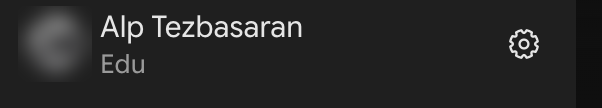

You need a laptop and your NC State login. Nothing to install, no coding.

## 1. Use your NC State account only {#account}

Only your NC State account is approved for university data, and the copy link in step 3 doesn't say which account it
uses. So use a window signed in to your NC State account only.

::: {.panel-tabset}
### Chrome

Click your profile picture (top right) → **Add Chrome profile**, sign in with your NC State email, and use that
window.

### Other browsers

Open a private window and sign in to [google.com](https://www.google.com) with your NC State email.
:::

## 2. Open Gemini once {#gemini}

1. Go to [gemini.google.com](). On a landing page, click **Chat with Gemini**.
2. Sign in with your NC State email if asked.
3. On the first-time notice, click **Use Gemini**.

**It works when** you see "Where should we start?" and your name with **Edu** under it, at the bottom left.

{.shot width="300" fig-alt="The bottom left corner of Gemini: a blurred profile photo, the name Alp Tezbasaran, and the word Edu under it."}

## 3. Copy the practice sheet {#copy}

Open the [copy link]() and click **Make a copy**. The copy is yours alone.

**It works when** it has five tabs (**Data**, **Dictionary**, **Work**, **Compare**, **About**), and the Data tab
ends at row .

That's all until the session.

## If something goes wrong

| Problem | Fix |
| --- | --- |
| Gemini or the copy shows your personal account | Switch accounts, or use the window from step 1. |
| Gemini isn't available | Check you're on your NC State email; then [go.ncsu.edu/getdatahelp](). |
| One tab only, or `24/1` shows as a date | You opened a downloaded file. Use the [copy link](). |
| Can't find your copy | Google Drive → **Recent**. |
| No time | Come anyway; we'll set up together. |

Checked ; if a screen differs, Google's
<a href="">Gemini help</a> wins.

