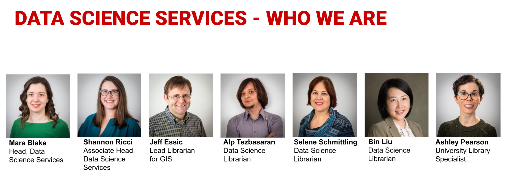
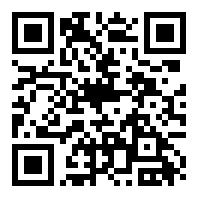

## While we get started

[]{.statement style="white-space:nowrap;font-size:0.82em"}

1. Open this page on your laptop
2. Have your NC State login ready

We'll set up together.

<!-- When the go link exists, make it the statement above, put images/qr-session.svg beside it in a .two-col, and
     update the footer. -->

## Data Science Services {.dss background-image="../images/dss/dss-services.png" background-size="contain" background-color="#FFFFFF" data-state="dss-slide"}

[Our services: consulting, workshops and instruction, specialized spaces. What we do: finding data, wrangling data, analyzing data, visualization, geographic information systems (GIS), software access.]{.visually-hidden}

## Who we are {.dss .dss-team .nostretch data-state="dss-slide"}

{fig-alt="Data Science Services, who we are: Mara Blake, Head, Data Science Services; Shannon Ricci, Associate Head, Data Science Services; Jeff Essic, Lead Librarian for GIS; Alp Tezbasaran, Data Science Librarian; Selene Schmittling, Data Science Librarian; Bin Liu, Data Science Librarian; Ashley Pearson, University Library Specialist"}

Our team comes from a variety of academic backgrounds, including nuclear engineering, electrical engineering, industrial and environmental engineering, marine ecology, information science, natural resources, business administration, and geographic information sciences.

## How to contact us {.dss background-image="../images/dss/dss-contact.png" background-size="contain" background-color="#FFFFFF" data-state="dss-slide"}

[How to contact us: go.ncsu.edu/getdatahelp. Email us, book a 30-minute appointment with a Data Science Consultant, or reserve a workstation in the DXL or Dataspace. All communication with the program is through getdatahelp@ncsu.edu.]{.visually-hidden}

## Tell us how we did

::: {style="text-align:center"}
[go.ncsu.edu/dss-workshop-eval](https://go.ncsu.edu/dss-workshop-eval){style="font-size:1.5em;font-weight:800"}

{.qr .qr-big fig-alt="QR code for the workshop evaluation, go.ncsu.edu/dss-workshop-eval"}
:::
